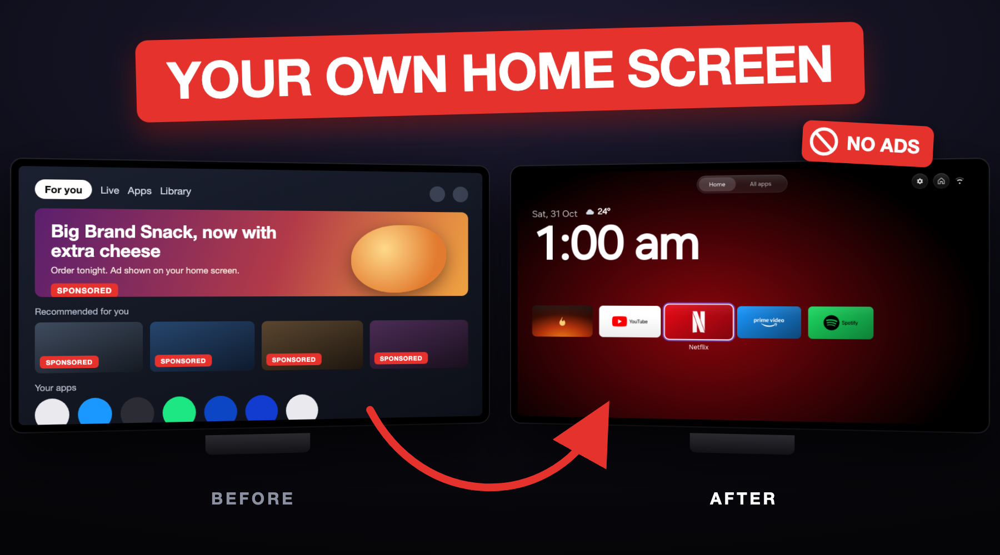
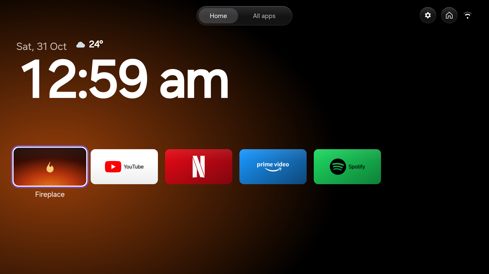
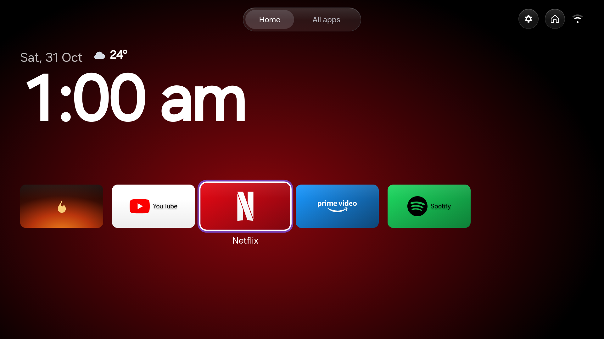
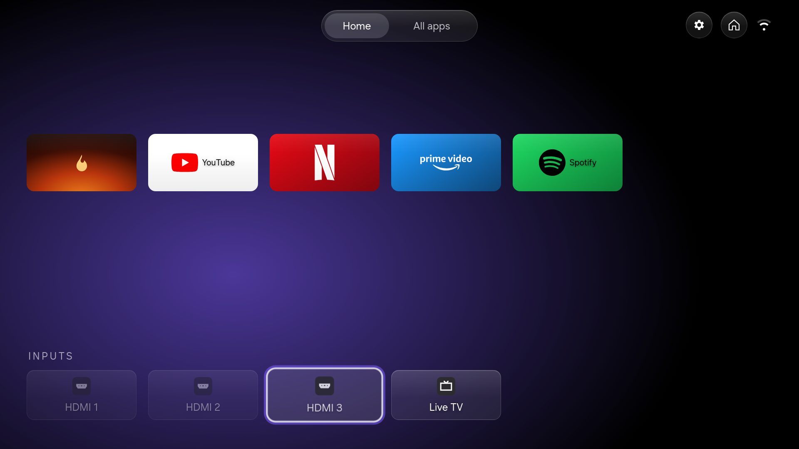
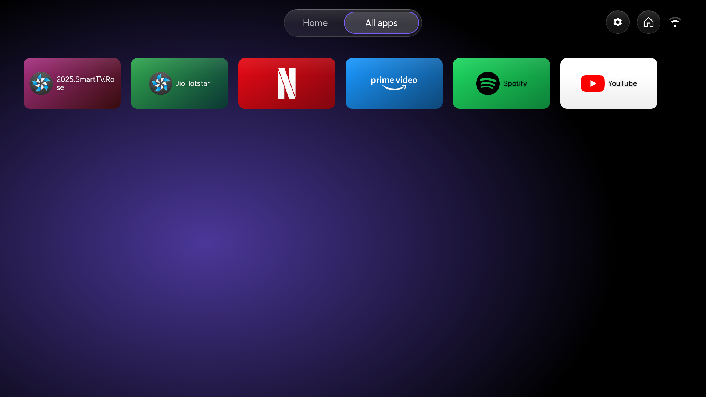
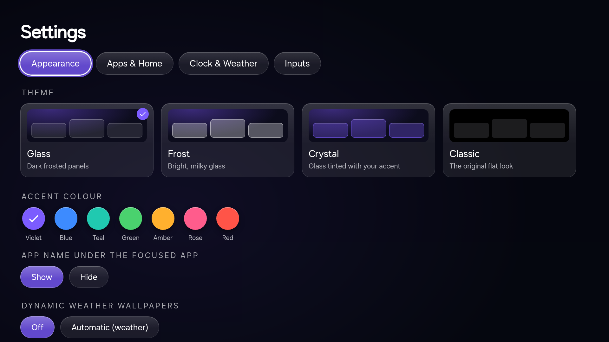

# tv-debloat



| 🧹 **Removes the junk** | 📺 **A calm home screen** | ↩️ **Undo anytime** |
|---|---|---|
| Bloatware, ads, sponsored rows and tracking, gone. | Your apps, your HDMI inputs and a clock. Nothing else. | Every change is backed up first and can be put back with one command. |

An AI-agent skill that turns a smart TV into a fast, ad-free TV with **your own home
screen**, from a computer on the same Wi-Fi. It walks the agent (Claude Code, CCode,
Codex, or any agent that reads `SKILL.md` skills) through it step by step:
read-only checks first, a backup before every change, and an undo for everything.



| Focused app with its colour halo | Inputs, one press below |
|---|---|
|  |  |
| **All apps** | **Settings: themes and accent colours** |
|  |  |

Screenshots are from a 2025 Samsung QLED (Tizen 9) running the launcher this skill builds.

## What it does

- **Samsung (2020+, Tizen):** turns on Developer Mode and installs the
  [AeroTizen](https://github.com/helalaou/AeroTizen) launcher, then sets it as the Home
  button and the app the TV opens at power-on. It can also apply this repo's redesign:
  - Glass, Frost, Crystal and Classic themes, and accent colours
  - a big clock, a row of apps along the bottom, and a halo in the focused app's colour
  - inputs one press below the screen, and tabs that switch as soon as you move onto them
  - a layout built to stay smooth on TV hardware
- **Android TV / Google TV / Fire TV:** connects over `adb` and installs a launcher APK.
  Debloating is reversible: it disables apps instead of deleting them, and keeps a list
  of packages it must never touch.
- **LG webOS, Roku and others:** says clearly what isn't possible without rooting (it
  won't root anything) and does the cleanup that is.
- **Bloatware, tracking and ads:** removes the apps the TV allows. It switches off
  tracking (ACR / "Viewing Information") in the TV menus and blocks ads and telemetry
  with DNS. A script checks which domains a DNS server actually blocks.
- **Your computer:** macOS, Linux or Windows.

## Install the skill

Copy `skills/custom-tv` into your agent's skills folder, for example:

```sh
git clone <this repository's URL> tv-debloat
cp -r tv-debloat/skills/custom-tv ~/.claude/skills/      # Claude Code
cp -r tv-debloat/skills/custom-tv ~/.ccode/skills/       # CCode
```

Then paste this into your agent, with your TV's details filled in:

```text
Use the custom-tv skill. My TV is a <brand and model>, at <TV IP>, on the same Wi-Fi
as this computer.

1. First tell me the risks in plain words and wait for my go-ahead.
2. Walk me through anything I have to do on the TV myself.
3. Before changing anything, list every app in three groups: needed by the TV,
   apps I use, and safe to turn off. Note free memory if the TV shows it.
4. Back up first, ask me before every single change, turn apps off rather than
   delete them where possible, and keep a log of each change and its undo.
5. Give me a clean home screen that opens with the Home button and at power-on.
6. Turn off tracking and block ads with DNS, explaining each setting.
7. Ask me if the TV is OLED; if it is, keep the screensaver on.
8. At the end, restart the TV once and check it starts normally before saying
   you're done, then show me the change log and how to undo everything.
```

The agent will ask before every change. A few steps happen on the TV (Developer Mode, a
Samsung sign-in for the signing certificate, unplugging the TV once), and it tells you
exactly where to go for each.

## Build the Samsung launcher yourself

```sh
skills/custom-tv/scripts/build_launcher.sh ./work      # needs git and Node 20.19+/22.12+
aerotizen --tv TV_IP install ./work/AeroTizen/dist/launcher
```

The redesign is `skills/custom-tv/patches/aerotizen-glass-tv-layout.patch`, applied to
AeroTizen commit `6457422`. The script applies the patch, builds, and runs AeroTizen's
lint, unit and browser tests. The design and its performance rules are written up in
[`references/launcher-design.md`](skills/custom-tv/references/launcher-design.md).

## Layout

```
skills/custom-tv/
  SKILL.md                      the workflow and safety rules
  references/                   per-platform guides, design spec, privacy, troubleshooting
  scripts/build_launcher.sh     clone, patch, build and test the Samsung launcher
  scripts/tv_screenshots.mjs    capture the launcher on the TV (hides the weather location)
  scripts/check_dns_blocking.sh test which ad/tracking domains a DNS server blocks
  patches/                      the AeroTizen redesign
docs/hero.png, docs/screenshots/
```

## Notes and warnings

> [!WARNING]
> **Do it at your own risk.** This changes how your TV starts and which apps it runs,
> using developer features the TV makers don't support. TVs can get stuck at the logo or
> keep restarting, and the AI can make mistakes. The skill asks you before every change
> and backs up first, and `aerotizen home restore` (Samsung) or re-enabling the disabled
> apps (Android) puts things back. This is what worked for us, not professional advice.
> You're responsible for your own TV, and nobody here is liable if something goes wrong.

> [!WARNING]
> **Samsung: keep the certificate and backup folders.** `~/.config/aerotizen/certs/` signs
> every launcher update; lose it and you have to uninstall and reinstall.
> `~/.config/aerotizen/backups/` holds the TV's original Home settings, which `home restore`
> needs. Never delete them or commit them anywhere. Restore Home *before* uninstalling the
> launcher, then unplug the TV for 60 seconds.

> [!WARNING]
> **Google TV and Chromecast with Google TV:** don't turn off the TV's own home screen app
> (`com.google.android.apps.tv.launcherx`). On some devices that left them stuck
> restarting, and the only fix was a factory reset. The cleanup still works with it left
> on.

> [!WARNING]
> **OLED TVs:** keep the screensaver on. It stops a still picture from burning into the
> screen. Don't leave any home screen, this one included, on for hours.

> [!NOTE]
> **No root, no exploits.** It only uses the manufacturer's own developer features. When
> the TV refuses something (Samsung's `can not uninstall app`), the agent stops and tells
> you how to do it in the TV's menus instead.

> [!NOTE]
> **Turn debugging off afterwards (Android, Google TV, Fire TV).** While USB, network or
> wireless debugging is on, other devices on your network can ask to control the TV. Turn
> it off once setup is done, and back on only to undo or update. Samsung's Developer Mode
> only accepts the one computer whose IP you entered; leave it on if you want updates and
> `home restore` to keep working.

## Credits

- [AeroTizen](https://github.com/helalaou/AeroTizen) (MIT) does the Samsung work: the CLI,
  the launcher, native Home and the DNS lists. The patch here is a derivative of it under
  the same license.

## License

MIT. See [LICENSE](LICENSE).
